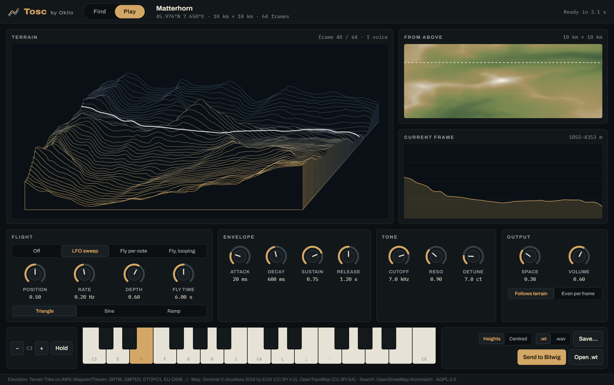
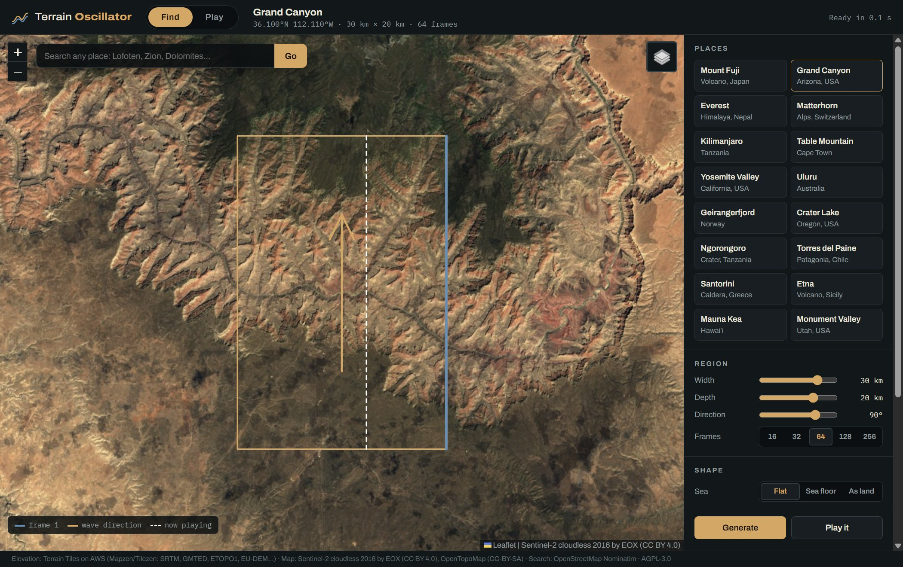

# Tosc

**A terrain oscillator: a wavetable synthesizer that plays real places.** Pick anywhere on Earth, and its terrain becomes the sound.

An [Okllo](https://okllo.com) instrument, made by inLXS. Standalone app, VST3, CLAP and AU (macOS).

## How it works

Each frame of the wavetable is one line across the land. Sweeping through the table flies you across it:
mountains become loud, bright peaks, valleys become dips, and the sea is silence. A canyon, a caldera and
a fjord each sound different because they *are* different.

1. **Find:** move the map, search any place, or pick one of the landmarks. Set the size and direction of the box and press **Generate**.
2. **Play:** play it from a MIDI keyboard, the computer keyboard or the on-screen keys. The white line shows where you are flying.
3. **Use it anywhere:** automate the flight in your DAW, or export the table as `.wt` (Bitwig, Surge) or `.wav` (Ableton Wavetable, Serum, Vital).

## Download

**[Get the latest release →](https://github.com/inlxs/tosc/releases/latest)**

| System | Download | Formats |
|---|---|---|
| Windows 10/11 (64-bit) | `Tosc-…-Windows.zip` | VST3, CLAP, Standalone |
| macOS 11+ (Apple silicon and Intel) | `Tosc-…-macOS.zip` | AU, VST3, CLAP, Standalone |
| Linux | build from source (see below); prebuilt downloads coming later | VST3, CLAP, Standalone |

Each download has an `INSTALL.txt` that says where to copy the files. In short:

- **Windows:** copy `Tosc.vst3` to `C:\Program Files\Common Files\VST3` and `Tosc.clap` to `C:\Program Files\Common Files\CLAP`.
  The standalone `.exe` runs from anywhere. It isn't code-signed yet, so SmartScreen asks once: *More info → Run anyway*.
- **macOS:** copy the plug-ins to `~/Library/Audio/Plug-Ins/` (`Components`, `VST3`, `CLAP`). The builds aren't notarised yet,
  so run the `xattr -dr com.apple.quarantine …` line from `INSTALL.txt` once after copying.
- **Linux:** no prebuilt download yet. Build from source, then copy to `~/.vst3` and `~/.clap` (needs WebKitGTK 4.1).

In your DAW it shows up under the maker **Okllo**. Use the CLAP in Bitwig and Reaper, the VST3 in Ableton Live, and the AU in Logic.

## Features

- **The whole planet:** elevation from the open [Terrain Tiles on AWS](https://registry.opendata.aws/terrain-tiles/), about 30 m detail on land plus sea floor. The map is Sentinel-2 satellite imagery or a topographic map.
- **Shape controls:** flat sea or sea floor, a height curve that lifts lowlands, a coast step, smoothing, and 16 to 256 frames.
- **Engine:** band-limited wavetables (11 mip levels, no aliasing on high notes) and 16 voices, each with:
  - up to 7 unison oscillators with detune and stereo width, a sine sub and analog-style drift;
  - its own filter: a 24 dB transistor ladder or a 12 dB nonlinear state-variable filter (LP, BP, HP), with anti-aliased drive and resonance that self-oscillates;
  - a filter envelope (amount up or down, key tracking, velocity) and an analog-style amp envelope;
  - glide, pitch bend and the sustain pedal.
- **Effects:** Juno-style chorus, ping-pong delay, a plate or hall reverb, and a look-ahead limiter.
- **Factory sounds:** Terrain pad, Glass pluck, Ridge bass, Fly over, Wind drone and Ridge lead.
- **Flight modes:** manual, LFO sweep, *fly per note* (each note travels across the land), and looping flight.
- **DAW friendly:** every control can be automated, and the table and the place are saved with your project.
- **MIDI:** the mod wheel flies across the terrain. CC74 cutoff, CC71 resonance, CC73 attack, CC75 decay, CC72 release,
  CC5 glide, CC93 chorus, CC91 reverb, CC7 volume, CC64 sustain, and pitch bend (±2 semitones).
- **Export:** `.wt` for Bitwig and Surge, `.wav` for Ableton Wavetable, Serum and Vital, or **Send to Bitwig**, which writes straight into your Bitwig library.
- **Command-line tool:** [`tools/terrain2wt.py`](tools/) turns any GeoTIFF into wavetables, including your own drone survey (OpenDroneMap DSM), national lidar or Copernicus 30 m.

## Build from source

Windows, with Visual Studio 2022 (Build Tools or Community) and the C++ workload:

    git clone --recurse-submodules https://github.com/inlxs/tosc.git
    cd tosc
    build.bat

macOS / Linux (see [the workflow](.github/workflows/build.yml) for the Linux packages):

    cmake -S . -B build -G Ninja -DCMAKE_BUILD_TYPE=Release
    cmake --build build

The results go to `build/Tosc_artefacts/Release/`. `RenderTest` renders a test phrase offline.
To work on the interface without rebuilding, set `TERRAIN_UI_DIR` to the `ui` folder. The app then loads the files from disk.

Every push builds Windows and macOS on GitHub Actions. Pushing a tag such as `v0.1.0` publishes a release with the downloads.

## Data credits

- Elevation: Terrain Tiles on AWS (Mapzen/Tilezen): SRTM, GMTED, ETOPO1, EU-DEM and others ([attribution](https://github.com/tilezen/joerd/blob/master/docs/attribution.md)).
- Built-in default table and `terrain2wt.py --copernicus`: Copernicus GLO-30 DEM, produced using Copernicus WorldDEM-30
  © DLR e.V. 2010-2014 and © Airbus Defence and Space GmbH 2014-2018, provided under COPERNICUS by the European Union and ESA.
- Map imagery: Sentinel-2 cloudless 2016 by EOX IT Services GmbH (CC BY 4.0), OpenTopoMap (CC-BY-SA). Search: OpenStreetMap Nominatim.

## Licence

AGPL-3.0-or-later (see [LICENSE](LICENSE)). Built with JUCE (AGPLv3), clap-juce-extensions (MIT) and Leaflet (BSD-2-Clause).
Made by inLXS · released under the [Okllo](https://okllo.com) name.
